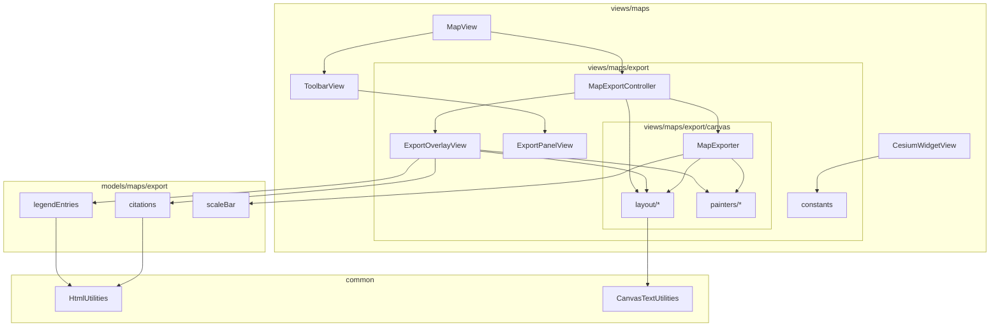
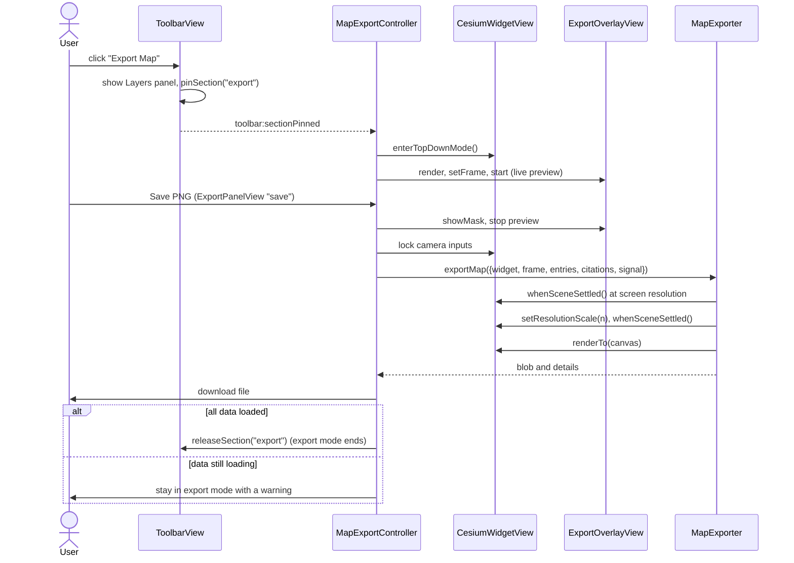

# Map Export

The map export tool lets a user download a PNG of the map they are looking at. The image has its own legend, scale bar and north arrow, and a band of data sources below the map. This document describes the feature, how it is implemented on the `feature-1777-export-map` branch, and the architectural decisions behind it. It replaces the original implementation plan, which was changed in several ways during development (see [Changes from the original plan](#changes-from-the-original-plan)).

Issue: #1777.

## Contents

- [The feature](#the-feature)
- [Enabling the tool](#enabling-the-tool)
- [Architecture](#architecture)
- [Runtime flow](#runtime-flow)
- [Component reference](#component-reference)
- [How the image is made](#how-the-image-is-made)
- [Waiting for the map data to load](#waiting-for-the-map-data-to-load)
- [Architectural decisions](#architectural-decisions)
- [Changes from the original plan](#changes-from-the-original-plan)
- [Bugs found and fixed during development](#bugs-found-and-fixed-during-development)
- [Testing](#testing)
- [Known limitations](#known-limitations)

## The feature

An **Export Map** link appears in the map toolbar, below **Download**. Clicking it puts the map into *export mode*:

- The toolbar shows the Layers panel, with the Export panel docked beneath it at the bottom.
- A dashed **frame** is drawn over the map. Whatever is inside the frame is what gets saved. The frame fills the part of the map that the toolbar sidebar does not cover, so resizing the browser window changes the frame (and the image size).
- A **live preview** of the legend, scale bar and north arrow is drawn inside the frame. It is drawn by the same code that draws the saved image, so the preview matches the result.
- The camera is locked to a **top-down view**. The user can pan, zoom and rotate the heading (right-drag, or Ctrl+left-drag). Tilting and looking around are disabled.
- The toolbar link column and the status bar become 75% transparent so more of the map is visible, and return to opaque on hover or keyboard focus. Link tooltips get the suffix "(Not shown in export)", except the pinned Export link. The **Download** link is disabled, with the tooltip suffix "(Unavailable while exporting)".
- The on-screen legend, the feature info box and the layer details box are hidden, because the export has its own legend and these would cover the frame. Features on the map cannot be hovered, clicked or selected: the cursor does not change to a pointer, clicking does nothing, and the URL's feature selection is not changed. An existing selection is kept, and it is shown again when export mode ends.
- The Export panel shows the output size in pixels, and notices such as "N layers did not fit in the legend", "the scale bar will be left out" or "the resolution will be reduced to fit within this device's memory limits".

**Save PNG** produces a file named `map-export-YYYYMMDD-HHMMSS.png`. The image is the frame rendered at up to 2× the on-screen resolution. Its legend, scale bar and north arrow sit on the map. Below the map there is a white band for any legend entries that did not fit, and a band of data citations.

Export mode ends only through:

- **Escape**,
- the panel's **Cancel** button or its close (X) button, or
- a **successful save**.

While the image is being created the map and toolbar are locked, and a "Preparing export" mask with its own Cancel button covers the map. Cancel or Escape during capture aborts only the capture; the user stays in export mode. A second Escape then leaves it.

If the map was still loading data when the image was saved, the file is still downloaded, but the panel stays open with a red warning that parts of the image may be missing, so the user can wait and save again.

## Enabling the tool

The tool is off by default. It is controlled by a map config flag, and requires the layer list:

```json
{
  "showToolbar": true,
  "showLayerList": true,
  "showExportMap": true
}
```

`showExportMap` is declared, documented and defaulted to `false` in [Map.js](../src/js/models/maps/Map.js), and is in the list of fields that are copied when a map config is cloned or serialized (`toConfig`). For a portal, set it in the `mapConfig` option of the visualization section.

## Architecture

The code is organized by **what each file depends on**, with imports running one way:



The rules are:

1. `common/` imports nothing from the export feature.
2. `models/maps/export/` reads `Map` and layer models and never touches the DOM or a view.
3. `views/maps/export/canvas/` draws and lays out the image. It has no Backbone views and no DOM other than a canvas. Layout modules are pure maths.
4. The Backbone views and the controller sit at the top of `views/maps/export/` and are the only modules that touch the page.

### File map

| File | Role |
|---|---|
| [src/js/models/maps/Map.js](../src/js/models/maps/Map.js) | `showExportMap` flag |
| [src/js/views/maps/MapView.js](../src/js/views/maps/MapView.js) | `renderExportController()` creates the controller after the toolbar is rendered, and includes it in `getSubViews` so it is closed with the view |
| [src/js/views/maps/ToolbarView.js](../src/js/views/maps/ToolbarView.js) | Export Map section, plus the pin/release, disabled-link and bottom-dock support |
| [src/js/views/maps/CesiumWidgetView.js](../src/js/views/maps/CesiumWidgetView.js) | Top-down mode, heading rotation, resolution scaling, settle detection, single-frame capture, view info |
| [src/js/views/maps/export/MapExportController.js](../src/js/views/maps/export/MapExportController.js) | The state machine that runs the tool |
| [src/js/views/maps/export/ExportPanelView.js](../src/js/views/maps/export/ExportPanelView.js) | The docked panel (template inlined as a string) |
| [src/js/views/maps/export/ExportOverlayView.js](../src/js/views/maps/export/ExportOverlayView.js) | The frame outline, the live preview canvas and the "Preparing export" mask |
| [src/js/views/maps/export/constants.js](../src/js/views/maps/export/constants.js) | Limits, timeouts and the `STYLE` object that all painters and layouts share |
| [src/js/views/maps/export/canvas/MapExporter.js](../src/js/views/maps/export/canvas/MapExporter.js) | Captures the scene and composes the PNG |
| `canvas/layout/FrameLayout.js` | Frame rectangle, resolution scale and crop |
| `canvas/layout/LegendLayout.js` | Measures legend entries and packs them into columns |
| `canvas/layout/CitationsLayout.js` | Wraps the sources text |
| `canvas/layout/PlacementLayout.js` | Places the scale bar and north arrow together |
| `canvas/layout/ExportLayout.js` | `compute()` combines the legend, overflow band and citations band |
| `canvas/painters/*` | `FramePainter`, `LegendPainter`, `ScaleBarPainter`, `NorthArrowPainter`, `CitationsPainter` |
| `models/maps/export/legendEntries.js` | Builds legend entries from visible layers |
| `models/maps/export/citations.js` | Builds source citations from visible layers |
| `models/maps/export/scaleBar.js` | Picks a "nice" scale bar length |
| `common/HtmlUtilities.js` | `htmlToText` |
| `common/CanvasTextUtilities.js` | `createMeasurer`, `wrapText` |
| [src/css/map-view.css](../src/css/map-view.css) | Export mode, overlay, panel, dock and disabled-link styles |

## Runtime flow

`MapExportController` has three states:

| State | Meaning |
|---|---|
| `idle` | Not exporting |
| `active` | The user is positioning the map |
| `capturing` | The image is being created; the map and toolbar are locked |



`exit()` is idempotent. It aborts any capture, removes the key and resize listeners, closes the overlay, unlocks the toolbar and camera, restores the normal camera controls and releases the toolbar section.

## Component reference

### Map model flag

`showExportMap` (default `false`) in `Map.js`. The toolbar section is hidden unless both `showExportMap` and `showLayerList` are true, because the export panel is shown together with the Layers panel.

### ToolbarView

The toolbar gained a general mechanism, not export-specific code:

- Each section option can have a `key`, a `dock: "bottom"` and `disabledWhilePinned`. Sections are found with `getSectionByKey(key)` instead of by link text.
- `pinSection(key)` activates a section and pins it. A pinned section stays visible when other sections are activated, `close()` does nothing, the section cannot be hidden by clicking its own link, and links with `disabledWhilePinned` (Download) are disabled with `aria-disabled`. It triggers `toolbar:sectionPinned`.
- `releaseSection(key)` reverses this and triggers `toolbar:sectionReleased`.
- `dock: "bottom"` replaces the earlier special case for `DownloadPanelView`. Docked content shrink-wraps and sits below the other active section. The class `toolbar__content--dock-bottom` is shared by Download and Export.
- The container lookups use `this.el.querySelector` instead of `document.querySelector`, so a toolbar does not pick up another toolbar's elements.
- The **Export Map** section has `key: "export"`, a map export icon, `view: ExportPanelView`, `dock: "bottom"`. Its `action` shows the Layers panel and calls `pinSection("export")`.

### MapExportController

[MapExportController](../src/js/views/maps/export/MapExportController.js) listens to the toolbar's pin and release events and to the panel's `save` and `cancel` events. It is the only component that knows about all the others.

- **Frame**: `getFrame()` asks `FrameLayout.computeFrameRect` for the map area not covered by the sidebar, inset by 12 px. It recomputes on window resize and on size changes of the map and the toolbar content (via `ResizeObserver`).
- **Panel updates**: `updatePanel()` computes the output size with `FrameLayout.computeResolutionScale` and builds the notices from the overlay's summary (overflowed layers, missing scale bar) and whether the resolution is reduced. It disables Save when the frame is under 320 × 160 CSS px.
- **Locking**: while capturing, `setInert(true)` makes the toolbar links and the other panels inert and disables camera inputs.
- **Save**: runs the exporter with an `AbortController`. Outcomes: a download and exit (settled), a download with a warning and no exit (not settled), "Export canceled" (aborted), or a red error (failed). File download uses an object URL that is revoked after 10 s.
- It accepts `exporter` and `downloadBlob` overrides so tests do not need a real GPU.
- It triggers `export:start`, `export:complete` (with the result) and `export:end`.

### ExportPanelView

A small Backbone view whose markup is an inline template string. It has no logic beyond rendering text and buttons: `setOutputSize`, `setNotices`, `setStatus` (announced to screen readers with `aria-live`), `setSaveEnabled`, and the `save` and `cancel` events. All text is written with `textContent`, never `innerHTML`.

### ExportOverlayView

Renders three layers over the map: the dashed frame, a preview `<canvas>` sized to the frame, and the mask.

- It paints the preview with `FramePainter.paintFrame`, the same call `MapExporter` makes for the saved image.
- It repaints on every scene `postRender` (coalesced with `requestAnimationFrame`) because the scale bar and north arrow depend on the camera.
- It re-reads the legend and citations when layers change (`change:visible`, `add`, `remove`, `reset`, `change:colorPalette`, `appearanceChanged`), and as a fallback at most every 150 ms while the scene renders. A content signature prevents needless relayout.
- It exposes a `summary` event (`overflowCount`, `extraHeight`, `scaleBarShown`), `getContent()` for the export, and `showMask` / `hideMask`.
- The overlay element does not create a stacking context, so the toolbar still covers the mask and the status bar still covers the preview.

### CesiumWidgetView additions

| Method | Purpose |
|---|---|
| `enterTopDownMode()` / `exitTopDownMode()` | Disable tilt and look, remove right-drag zoom, bind heading rotation, and fly to look straight down at the screen center. Restores the saved controller settings on exit. |
| `enforceTopDown()` | On camera `changed`, resets pitch and roll if they drift more than 0.5° from nadir. |
| `applyTopDownToOptions()` / `applyTopDownToFlightTarget()` | Keep "Reset" and "zoom to layer" flights pointing down while locked. |
| `bindHeadingRotation()` / `rotateHeadingBy()` | Pointer-event handling for right-drag and Ctrl+left-drag. Uses `camera.twistRight`. Also suppresses the context menu. |
| `setCameraInputsEnabled()` | Used to lock the camera during capture. |
| `setResolutionScale(scale)` | Scales the Cesium widget's resolution and the screen-space error of the globe and 3D tilesets by the same factor, so extra pixels show finer detail. Resizes the canvas immediately. Restores the baseline when called with 1. |
| `getPixelRatio()` | Drawing-buffer pixels per CSS pixel, with the current resolution scale divided out. |
| `getRenderLimits()` | GPU maximums (viewport, renderbuffer). |
| `getTilesets()`, `getPendingTilesets()`, `getUnsettledCount()`, `isSceneIdle()`, `whenSceneSettled()` | Settle detection (see [below](#waiting-for-the-map-data-to-load)). |
| `applyCleanScene()` / `renderTo(draw)` | Hide interactive-only drawing (3D tile selection silhouettes, the FPS display), render one frame and hand the canvas to a callback synchronously. |
| `getExportViewInfo(frame)` | Meters per pixel near the lower right of the frame (via `pixelToMeters(anchor)`) and the north rotation. |
| `pixelToMeters(anchor)` | Existing method, now accepts an optional anchor point. |

### MapExporter

[exportMap](../src/js/views/maps/export/canvas/MapExporter.js) lays out the content, then for each attempt:

1. Waits for the preview-resolution tiles (`loadingPreview`).
2. Sets the resolution scale and waits again for the higher-resolution data (`loadingDetail`).
3. Computes the scale bar and north arrow placement.
4. Renders one frame and crops the frame region out of it.
5. Draws the frame overlays, the overflow band and the citations band, and creates the PNG (`rendering`).

If an attempt throws (typically running out of GPU memory), it retries with the factor multiplied by 0.75, at most twice. The widget's resolution is always restored in a `finally`. It returns `{ blob, width, height, scale, reducedResolution, settled, scaleBarShown }`.

### Layout modules

All layout code is pure maths. Text is measured through an injected `measure(text, fontPx, bold)` function, so the logic is tested without a canvas.

- **FrameLayout**: `computeFrameRect`, `computeResolutionScale`, `computeCrop`.
- **LegendLayout**: `measureEntry`, `packBlocks`, `layoutLegend`. The legend fills at most half the frame's width and height. It first tries the normal spacing at the full font, then tight spacing while shrinking the font from 13 px to 10 px. Entries that still do not fit are returned as `overflow`. In `band` mode there is no height limit and entries are balanced across columns.
- **CitationsLayout**: `layoutCitations`, wrapped to the frame width.
- **PlacementLayout**: `placeControls` places the scale bar and north arrow together, since the arrangement depends on room left by the legend. In order of preference the arrangements are `row` (bar, units and arrow side by side), `labelAbove` (units above the bar, arrow beside it) and `stacked` (arrow above the bar).
- **ExportLayout**: `compute` combines the legend (bottom left of the frame), the overflow band and the citations band, and reports `overflowCount` and `extraHeight`.

### Painters

Canvas 2D painters that draw in CSS pixels. The caller sets the context transform to scale the drawing, which is how one painter serves both the live preview (device pixel ratio) and the export (up to 2×). `FramePainter.paintFrame` is the single entry point that draws the legend, scale bar and north arrow; `CitationsPainter` draws the bands below the frame.

### Model readers

- **legendEntries**: one entry per visible layer that has a color palette, is not `hideInLegend` and has colors. Categorical entries skip categories that a categorical filter on the palette's property excludes. Continuous entries produce gradient stops and min, mid and max labels. It uses the same inclusion rules as the on-screen legend and never changes model state.
- **citations**: the visible layers' `attribution`, or the imagery provider's credit when a layer has none. Layers with identical text are grouped ("Layer A, Layer B: text").
- **scaleBar**: `chooseScaleBar` picks the largest distance from the same table the on-screen `ScaleBarView` uses that fits within 150 px.

### Common utilities

- `HtmlUtilities.htmlToText` converts layer labels such as `CO<sub>2</sub>` to plain text using a `DOMParser` document, so no scripts or event handlers run.
- `CanvasTextUtilities.createMeasurer(ctx, fontFamily)` and `wrapText`. The font family is a parameter so `common/` does not depend on the export constants.

## How the image is made

**Rendering approach.** The image is not a screenshot of the page. The same Cesium scene is re-rendered at a larger resolution, so the map is sharp rather than an enlarged screenshot, and then the frame region is cropped from the canvas.

**Resolution.** The target is `EXPORT_RESOLUTION_MULTIPLIER` (2×) the on-screen drawing buffer. `computeResolutionScale` lowers it to respect the GPU's max viewport and renderbuffer size and a limit of 64 million pixels in either the whole canvas or the output. The whole widget is rendered, not just the frame, so the canvas limit uses the widget's size. The scale is truncated to two decimals so sizes stay stable. The panel shows the exact output size and warns when the resolution is reduced.

**Composition** (all coordinates in CSS pixels, drawn with a scale of crop width ÷ frame width):

```
+--------------------------------------+
| map (cropped frame)                  |
|   legend (bottom left)               |
|            scale bar + north arrow   |
|            (bottom right)            |
+--------------------------------------+
| Legend (continued)  - overflow band  |
+--------------------------------------+
| DATA CITATIONS      - sources band   |
+--------------------------------------+
```

The bands have a white background. Their heights are part of the output size shown in the panel.

**Scale bar and north arrow.** The scale comes from the camera at a point three quarters across and at the bottom of the frame. If the ground cannot be picked there (for example the frame shows space), the scale bar is left out and the panel says so. The north arrow rotates with the camera heading.

## Waiting for the map data to load

Cesium loads tiles lazily and the scene uses explicit rendering, so the exporter has to decide when the map has everything it needs. `whenSceneSettled` resolves with `settled: true` when the scene has been idle for 500 ms and at least 3 frames have rendered.

The scene counts as unsettled when any of these is true:

- the globe has not loaded its tiles,
- a **visible** 3D tileset has not loaded its tiles. Hidden layers are excluded (see the bug fixes),
- the vector data sources' visualizers are not ready. They are polled directly through `updateAllDataSources()`.

Instead of a fixed time limit it is **progress-based**. It gives up (`settled: false`) when nothing has progressed for 20 s (`EXPORT_SETTLE_STALL_MS`), or after 3 minutes in total (`EXPORT_SETTLE_TIMEOUT_MS`). Progress is any of: a tileset loading another tile, the globe finishing a tile, or the unsettled count dropping. When it gives up it logs a `console.warn` listing what was still pending (pending tile count, globe state, each pending tileset with its request statistics and the time waited), so support can see why.

The wait is done twice: first for the preview tiles at the on-screen resolution, then again after the resolution scale is applied, because the higher resolution needs tiles at finer levels of detail. The panel and mask show "Waiting for preview tiles…" and "Loading higher resolution data…" for the two phases.

## Architectural decisions

**Gate by a map flag, not a global setting.** `showExportMap` is opt-in per map, like `showDownloadPanel`. Export needs the layer list, so both flags are required. This keeps the tool out of maps that have not been tested with it.

**Build on the toolbar rather than a modal.** The export panel is a toolbar section that is *pinned*. This reuses the existing docking and layout, keeps the Layers panel visible so the user can change what is in the legend, and lets other toolbar features keep working. The cost was a pin/release API and a `dock` option on the toolbar, which are general and also replaced the old `DownloadPanelView` special case.

**One controller owns the lifecycle; views stay passive.** `MapExportController` is the only place that knows the order of events. `ExportPanelView` and `ExportOverlayView` only render and trigger events. This made the controller easy to test with fake exporters and a fake widget.

**The preview and the image share the same layout and painters.** The live preview is drawn by `FramePainter` with the same `ExportLayout`/`PlacementLayout` results as the saved file, so there is no second implementation that can drift from what is saved. Pure layout functions with an injected text measurer make this testable without a canvas.

**Re-render the Cesium scene instead of capturing the page.** A page screenshot is limited to the screen resolution and cannot render the overlay at a different scale. Re-rendering at a multiple of the resolution, with the screen-space error divided by the same factor, produces real extra detail. The canvas does not preserve its drawing buffer, so `renderTo` renders and hands the canvas to a callback that must copy it synchronously.

**Lock the camera to a top-down view.** A map with a scale bar and a north arrow only makes sense when viewed from above. The lock is implemented by disabling tilt and look, correcting drift in `enforceTopDown`, and overriding the pitch of programmatic flights. Heading rotation uses custom pointer bindings (right-drag and Ctrl+left-drag) because Cesium's right-drag is used for zoom; the right-drag zoom binding is removed while locked. The saved controller settings are restored on exit.

**Hide the on-screen panels, and make features non-interactive, while exporting.** The export draws its own legend, and the legend, feature info box and layer details box sit over the map and would cover the frame. The controller adds the class `map-view--export-mode` to the map view, and [map-view.css](../src/css/map-view.css) sets `display: none` on `.legend-container`, `.map-view__feature-info-container` and `.map-view__layer-details-container`. The overlay view does not change these panels. Hiding with CSS clears no selection state and removes no view.

Features are made non-interactive rather than leaving the feature info box open over the map, so it cannot block the frame or overlay. The controller calls `disableFeatureInteraction()` on the map's `MapInteraction` model when export mode starts and `enableFeatureInteraction()` when it ends. While disabled, `MapInteraction` ignores clicks (`handleClick`), `setHoveredFeatures` and `selectFeatures`, and clears the hovered features. This has these effects:

- The map cursor never becomes a pointer, because `CesiumWidgetView.updateCursor` follows the hovered features.
- Clicking a feature does not select it, zoom to it or open the feature info box.
- Nothing writes a selection to the URL, because the URL sync listens to the selected features. Because the check is in `selectFeatures`, it also covers selection by search, the viewfinder and URL restore, not only clicks.
- A feature that was already selected stays selected, and is not written to or removed from the URL. Its feature info box reappears when export mode ends.

The selection silhouettes that Cesium draws on 3D tiles are handled separately, by `applyCleanScene()`, which hides them while the image is rendered.

**Progress-based settling with a stall limit.** A fixed time limit was either too short for large 3D tilesets or too long when nothing was loading (see the bug fixes). Measuring progress means a slow but moving load keeps going, and a stuck one ends quickly.

**Never silently produce an incomplete image.** If loading did not finish, the file is still saved (the user may not be able to wait), but the panel stays open with a warning, and a `console.warn` records the details.

**Cancel has two scopes.** Cancel during capture aborts only the capture (via `AbortController`), because the user has spent effort positioning the map. Leaving export mode takes a second action.

**Sources come from layer metadata, not from Cesium's credit display.** Cesium's on-screen credits are DOM-only and cannot be captured. The citations come from each visible layer's `attribution`, falling back to the imagery provider's credit.

**Code is organized by what it depends on.** See [Architecture](#architecture). Export code was first put in `common/mapExport/`, but nothing outside the export used it, and it depended on the map models. It was then split by dependency so that general helpers (`HtmlUtilities`, `CanvasTextUtilities`) live in `common/`, model readers in `models/maps/export/`, and drawing code under `views/maps/export/canvas/`. The module names follow the `views/maps/viewfinder` precedent for a feature folder inside `views/maps`.

**The panel template is a string inside the view.** The template is short and has no logic, so it lives in `ExportPanelView.js` with the BLOCK class name interpolated, rather than as a separate `.html` file and a `text!` dependency.

**Security.** Layer labels may contain HTML, so `htmlToText` parses them into an inert document. Status and notice text is set with `textContent`. The test suite includes a check that an `onerror` handler in a label never runs.

## Changes from the original plan

| Topic | Original plan | What was built |
|---|---|---|
| File location | `common/mapExport/*` and views in `views/maps/` | Reorganized by dependency: `common/`, `models/maps/export/`, `views/maps/export/`, `views/maps/export/canvas/` |
| Layout code | One `ExportLayout` module | Split into `FrameLayout`, `LegendLayout`, `CitationsLayout`, `PlacementLayout` and a combining `ExportLayout` |
| Scale bar and north arrow placement | Independent `placeScaleBar` and `placeNorthArrow` | A single `placeControls` that chooses a `row`, `labelAbove` or `stacked` arrangement based on width. The units sit to the right of the bar by default, and the arrow has a large N with a triangle |
| Text helpers | In `ExportLayout` | `common/CanvasTextUtilities.js`, taking the font family as an argument |
| HTML to text | `htmlText.js` in the export folder | `common/HtmlUtilities.js` |
| Panel template | Separate `export-panel.html` | Inline string in `ExportPanelView.js` |
| Waiting for data | A fixed 45 s limit, then export anyway | Progress-based wait: 20 s without progress, 3 min total, two phases (preview then detail), with status messages |
| Incomplete export | The file was downloaded and export mode ended | The file is downloaded, but export mode stays open with a red warning so the user can retry |
| Data readiness check | `dataSourceDisplay.ready` | Polls the visualizers directly, because that flag is never set (see below) |
| Toolbar icons | Existing Font Awesome icons | Download and Export use SVG icons from the design files, and the toolbar icons were centered |
| Preview content updates | Redraw after each rendered frame, debounced | Layer changes refresh the preview immediately, with a throttled fallback |
| Resolution handling | Scale set during capture | Resolution is applied after the preview tiles load, and `setResolutionScale` resizes the canvas immediately |

## Bugs found and fixed during development

- **Every export took the full time limit.** `isSceneIdle()` required `dataSourceDisplay.ready`, but that flag is only set by Cesium's `DataSourceDisplay.update()`, which this app never calls. It stayed false, so every export waited out the limit regardless of image size. The scene check now calls `updateAllDataSources()` to poll the visualizers directly, and logs what it was waiting for if it gives up.
- **The fixed 45 s limit was wrong in both directions.** It was too short for very large 3D tilesets and too long when nothing was loading. It was replaced by the progress-based wait.
- **Hidden layers were waited for.** A hidden layer's tileset keeps its `show` flag on and keeps requesting tiles, so `tilesLoaded` stayed false. `getPendingTilesets()` now also requires the tileset's layer to pass `isVisible()` (covering visibility off, opacity 0 and temporarily hidden layers), and the wait and the "gave up" log use the same definition.
- **The output size doubled after an unsettled export.** After the resolution was reset to 1 the canvas kept its enlarged size until the next frame, so the panel read a pixel ratio of 2 and recomputed a doubled size. `setResolutionScale()` now resizes the canvas immediately and `getPixelRatio()` divides out the current scale.
- **Legend changes in the preview could take seconds.** The preview was refreshed from a debounced `postRender` handler, which never fired while tiles were loading because the scene kept rendering. It now listens for layer changes directly and uses a throttle for the fallback.
- **A stray syntax error** from an edit left unterminated comment lines in `CesiumWidgetView.js`, which failed to load the widget in tests.
- **Test infrastructure**: sinon-chai matchers are not loaded in this suite, so assertions use `spy.callCount` and `spy.calledWith(...)`. The XSS test deletes the window global it uses so Mocha's leak detection passes.

## Testing

Unit specs are registered in [test/config/tests.json](../test/config/tests.json) and mirror the source layout:

| Spec | Covers |
|---|---|
| `test/js/specs/unit/common/HtmlUtilities.spec.js` | HTML to text, including that scripts and handlers do not run |
| `test/js/specs/unit/common/CanvasTextUtilities.spec.js` | Measurer and text wrapping |
| `test/js/specs/unit/models/maps/export/mapContent.spec.js` | Legend entries and citations from Map models |
| `test/js/specs/unit/models/maps/export/scaleBar.spec.js` | Scale bar choice and labels |
| `test/js/specs/unit/views/maps/export/canvas/ExportLayout.spec.js` | Frame, resolution, crop, legend packing, overflow, citations and control placement |
| `test/js/specs/unit/views/maps/export/MapExport.spec.js` | The map flag, the toolbar section and pinning, the panel, the controller's states and flows (save, cancel, fail, incomplete) and the overlay |

Run them with `npm test`.

A real browser is still needed to check the behaviors the unit tests cannot: heading rotation direction and feel, context menu suppression on macOS Ctrl+click, tile refinement at 2×, and large exports on low-memory GPUs.

## Known limitations

- Heading rotation uses a mouse or trackpad drag. Touch gestures only zoom; touch rotation is not supported.
- Credits that exist only in the DOM (for example Google's) are not captured. Sources come from the layer `attribution` or the imagery provider credit.
- The export depends on the data being loaded. If the data does not finish loading (stalled for 20 s or 3 min total) the image is downloaded with a warning and may be missing detail.
- The tool needs a frame of at least 320 × 160 CSS px, and the output is limited by the GPU and by 64 million pixels; the panel reports a reduced resolution.
- The tool only works in 3D (Cesium SCENE3D) mode, as the top-down lock is not applied in other scene modes.